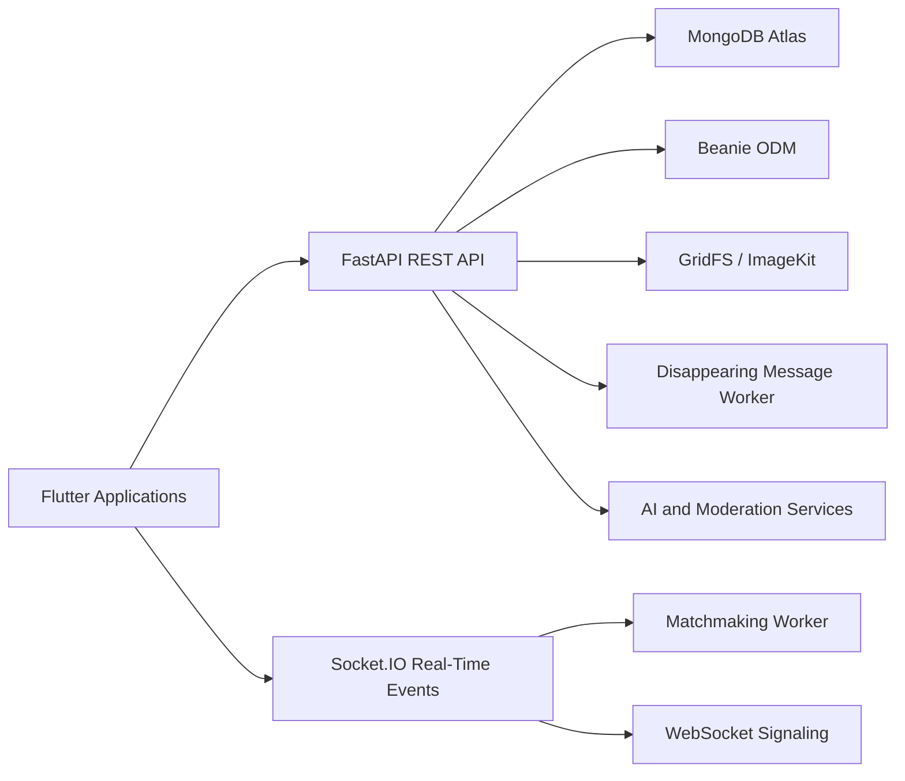
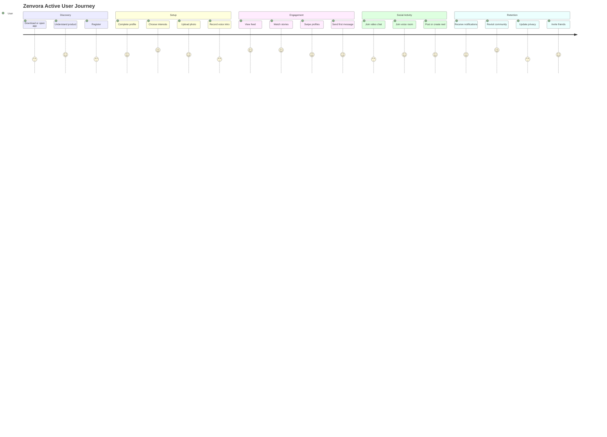
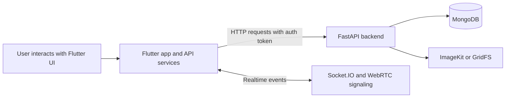

# Zenvora Project Analysis

> This analysis is based on the repository structure, Flutter/FastAPI implementation, API documentation, and existing audit reports. It does not include live user research or runtime testing.

## 1. Product Summary

Zenvora is a **cross-platform social networking application** for Android, iOS, Web, Windows, macOS, and Linux.

Core positioning:

- Anonymous or semi-anonymous social identity
- Short-form social content
- Profile discovery and matching
- Random video chat
- Disappearing direct messages
- Stories and reels
- Communities and voice rooms
- Creator monetization
- Trust, reporting, moderation, and administration

The primary experience combines features commonly found in Instagram, Tinder, Snapchat, Omegle, and community platforms.

---

## 2. Developer Perspective

### Technology Architecture

### Frontend Architecture

The Flutter application uses:

- `provider` for state management
- `go_router` for navigation
- `flutter_secure_storage` for credentials
- `socket_io_client` for real-time communication
- `flutter_webrtc` for video chat
- `livekit_client` for voice/video infrastructure
- `cached_network_image` and `video_player` for media
- `flutter_card_swiper` for discovery cards
- Material 3 with a custom dark theme

The main application setup is in [main.dart](lib/main.dart:53).

Navigation includes:

- Home feed
- Discover
- Search
- Reels
- Notifications
- Profile
- Direct messages
- Random video chat
- Voice rooms
- Administrative console

The bottom navigation implementation is in [home_screen.dart](lib/features/home/home_screen.dart:140).

### Backend Architecture

The FastAPI backend is modular and has separate routers for:

- Authentication
- Profiles and users
- Posts
- Stories
- Reels
- Chats
- Discovery
- Swipe and matching
- Voice rooms
- Calls
- Communities
- AI
- Notifications
- Creator tools
- Monetization
- Livestreaming
- Administration
- Recommendations
- Reports
- Media
- Notes

Backend startup and router registration are visible in [main.py](backend/models/app/main.py:1).

The backend also starts:

- Adaptive matchmaking worker
- Disappearing-message cleanup worker
- MongoDB/Beanie initialization
- Admin account seeding
- Database health monitoring

### Development Strengths

#### 1. Modular Feature Organization

The Flutter and Python codebases are divided into feature-specific folders and routers. This is beneficial for team ownership and future extension.

#### 2. Cross-Platform Coverage

One Flutter codebase can support mobile, web, and desktop platforms.

#### 3. Real-Time Product Differentiation

The project does not only provide a REST social feed. It also implements:

- Socket.IO
- WebRTC
- LiveKit
- matchmaking
- voice rooms
- live calls
- WebSocket signaling

#### 4. MongoDB Suitable for Dynamic Social Data

The flexible document model supports:

- posts
- stories
- user profiles
- chat records
- voice rooms
- swipe history
- dynamic recommendation data

#### 5. Strong Privacy Feature Set

The implementation is designed around:

- close-friends stories
- hidden stories
- blocking
- disappearing messages
- private accounts
- follow requests
- ghost identities
- trust scores
- reporting

### Developer Risks and Concerns

| Area | Concern | Recommended Action |
|---|---|---|
| Identity | “Anonymous” accounts still collect real names and email addresses | Clearly document identity model and anonymization boundaries |
| Secrets | Login currently prints API response and saved token with `debugPrint` | Remove sensitive debug logging immediately |
| Admin provisioning | The backend has a default admin credential fallback | Replace with mandatory environment secrets and rotate credentials |
| E2EE | The audit claims E2EE, but implementation correctness depends on key management | Perform cryptographic and key-rotation review |
| Media storage | Production media currently depends on fallback storage and external CDN configuration | Move to managed object storage with lifecycle policies |
| Testing | Existing tests cover backend features, but UI and platform testing appears limited | Add widget, integration, accessibility, and device tests |
| Feature complexity | Numerous social features share the same backend | Create service boundaries and prevent router-level duplication |
| API contracts | A growing number of endpoints may change independently | Define versioned OpenAPI contracts |
| Security claims | Existing audit reports state secure behavior | Validate through independent penetration testing |
| Operations | Production observability is not described deeply | Add tracing, metrics, alerts, backup tests, and incident dashboards |
| Offline support | Cross-platform app is mostly network-driven | Add cache, retry queues, and graceful degraded mode |

A concrete security concern exists in [login_screen.dart](lib/features/auth/login/login_screen.dart:33), where the login response and token are written to debug output.

### Recommended Developer Priorities

1. Remove sensitive logging.
2. Eliminate hardcoded credential fallbacks.
3. Establish CI/CD pipelines for Flutter and FastAPI.
4. Add end-to-end encryption threat modeling.
5. Separate the authentication/session service from UI state.
6. Add API and database migrations.
7. Introduce structured metrics and error reporting.
8. Reduce large feature screens into reusable widgets.
9. Add automated tests for swipe, stories, chat expiration, and matchmaking.
10. Complete backup, restore, abuse, and moderation procedures.

---

## 3. User Perspective

### Primary Personas

#### Persona 1: The Curious College Student

**Goals**

- Meet people with similar interests
- Join entertaining conversations
- Express thoughts anonymously
- Avoid heavy social-pressure environments
- Discover trends and creators

**Needs**

- Fast onboarding
- Real and relevant profile matches
- Simple privacy controls
- Reliable random chat
- Visually engaging short-form content

**Frustrations**

- Too many setup steps
- Fake or low-quality profiles
- Inappropriate messages
- Confusing privacy boundaries
- Slow media loading

#### Persona 2: The Privacy-Conscious Creator

**Goals**

- Publish content
- Control audience visibility
- Build a close-follower community
- Understand engagement
- Monetize safely

**Needs**

- Fine-grained story audience controls
- Clear analytics
- Moderation tools
- Direct response management
- Repost attribution

#### Persona 3: The Administrator or Moderator

**Goals**

- Detect harmful content
- Review reports
- Control broadcasts
- Monitor unsafe conversations
- Manage users and communities

**Needs**

- Fast investigations
- Effective search and filtering
- Clear evidence trails
- Account action controls
- Analytics and alerts

### User Value Proposition

Zenvora can deliver:

> “A safe, expressive, anonymous-first social space where users can discover people, share moments, join conversations, and create communities.”

### Onboarding

The onboarding flow collects:

- Gender and attraction preferences
- Profile photo
- Bio
- Personality type
- Interests
- Voice introduction
- Age and discovery ranges

This is implemented in [onboarding_screen.dart](lib/features/auth/register/onboarding_screen.dart:11).

The experience is rich but potentially overwhelming. Seven onboarding stages mean Zenvora must show clear progress and communicate the benefit of each step.

### Daily Feed Use

A user can:

1. View stories
2. Browse trending content
3. Read or create posts
4. Like, comment, repost, or share
5. Refresh the feed
6. Navigate to reels or activity

The feed is implemented in [feed_screen.dart](lib/features/posts/feed_screen.dart:1).

### Discovery Use

A user can:

- Filter by gender
- Filter by interest
- Filter by country
- Swipe right to like or follow
- Swipe left to skip
- Undo a previous swipe
- Reset discovery history
- View a complete profile

The swipe experience is in [discovery_screen.dart](lib/features/discover/discovery_screen.dart:1).

### Communication Use

A user can:

- Open direct messages
- Reply to messages
- React with emoji
- Send voice, image, or video content
- Configure disappearing-message behavior
- Block or report conversations
- Start calls

### Random Video Chat Use

A user:

1. Opens “Omegle Video Chat”
2. Joins the matchmaking queue
3. Waits for a suitable stranger
4. Sends WebRTC offers and answers
5. Talks or ends the call
6. Rematches or exits

The matchmaking flow is in [matchmaking_screen.dart](lib/features/random_chat/matchmaking_screen.dart:1).

The major user risk is immediate exposure to unknown users. Zenvora should prioritize trust score visibility, rapid reporting, and behavior-based matching.

---

## 4. User Journey Map

### Main Journey: New User to Active Community Member

| Stage | User Action | User Thought | Emotional State | Pain Point | Touchpoint | Opportunity |
|---|---|---|---|---|---|---|
| Awareness | Finds Zenvora through a friend or social campaign | “Is this another social app?” | Curious | Value is unclear | Landing page, promotion | Explain uniqueness in 10 seconds |
| Splash | Opens app | “Will this load quickly?” | Expectant | Waiting or connection failure | Splash screen | Fast initialization and offline feedback |
| Registration | Creates account | “How much information is required?” | Cautious | Repeated or sensitive data requests | Registration | Progressive, transparent onboarding |
| OTP | Verifies email | “Did I enter the right email?” | Impatient | Email delay or missing inbox | OTP screen | Resend timer and expiration details |
| Onboarding | Sets gender, interests, photo, bio, and voice intro | “Will this improve my matches?” | Excited or burdened | Seven lengthy stages | Onboarding | Save progress and indicate benefits |
| First Home Visit | Sees feed and stories | “Is there interesting content?” | Curious | Empty or irrelevant feed | Feed | Seed recommendations and prompts |
| Discovery | Opens profile cards | “Are these real people?” | Interested or skeptical | Repeated or inappropriate profiles | Discover | Improve profiles and candidate quality |
| First Match | Likes or follows someone | “Did they accept?” | Anticipatory | Waiting for response | Notifications | Explain private versus public account behavior |
| First Conversation | Sends a message | “Are they responsive?” | Hopeful | No reply or unsafe conversation | Chat | Icebreakers and safety prompts |
| Random Chat | Joins video queue | “Am I safe meeting a stranger?” | Excited or anxious | Harassment or poor connection | Matchmaking | Report shortcut and better matching |
| Community | Joins a room or creator community | “Do I belong here?” | Engaged | Group rules or moderation unclear | Rooms | Membership introductions and moderation summaries |
| Contribution | Posts, reposts, or creates a reel | “Will people respond?” | Creative | Low initial reach | Creator tools | Highlight feedback and optimize reach |
| Return | Returns during the week | “Did anything important happen?” | Loyal or disappointed | Notification overload | Notifications | Personalized notification priorities |
| Churn Risk | Finds less relevant content | “Why is this not useful anymore?” | Frustrated | Poor recommendations | Feed/discovery | Refresh interests and provide user controls |

### Key Journey Bottlenecks

#### 1. Onboarding Too Large

Seven setup stages can reduce conversion. Essential steps should be completed first, while interests and voice intro may be deferred.

#### 2. Empty First Feed

New users need immediate, relevant content before they build a following.

#### 3. Lack of Trust Explanation

Users should understand:

- why a profile is displayed
- whether an account is verified
- whether a match is relevant
- why they received an invitation or recommendation

#### 4. Random Chat Anxiety

Random video chat needs stronger:

- consent screens
- age assurances
- report buttons
- behavior controls
- moderation fallback

#### 5. Notification Overload

The app combines social, follow, chat, moderation, and system notifications. Notification ranking is essential.

---

## 5. SCAMPER Analysis

SCAMPER stands for:

- **S**ubstitute
- **C**ombine
- **A**dapt
- **M**odify
- **P**ut to another use
- **E**liminate
- **R**everse/Rearrange

### S — Substitute

| Existing Element | Proposed Replacement | Benefit |
|---|---|---|
| Real-name registration | Optional anonymous identities | Supports privacy-led positioning |
| Swipe-only discovery | Swipe plus intent-based discovery | Better matches and fewer random profiles |
| Static profile cards | Voice intro, interests, and compatibility preview | Helps users evaluate personality |
| Generic feed ranking | Explainable interest and behavior ranking | Reduces opaque recommendations |
| Traditional search | Topic, mood, community, and anonymous search | Better discovery |
| Text OTP | Passkeys or secure social login | Faster and safer authentication |

### C — Combine

Combine related experiences into stronger journeys:

- Stories + communities + close friends
- Profile discovery + voice introductions
- Feed + AI content assistant
- Matchmaking + interest rooms
- Reels + live streaming
- Reports + automatic trust-score updates
- Monetization + creator analytics
- Chat + disappearing media + voice notes
- Discover + first-conversation icebreakers

A valuable feature could be **“Interest Circles”**:

- automatically combines discovery
- conversation groups
- voice rooms
- community posts
- weekly prompts
- trust/reputation features

### A — Adapt

Zenvora can adapt proven concepts:

- Dating-app matching → compatible friend discovery
- Social moderation → community trust systems
- Gaming matchmaking → interest and behavior matching
- Marketplaces → creator tipping and digital gifts
- Spotify or Netflix recommendations → explainable content feeds
- Discord channels → moderated anonymous communities
- Snapchat temporary media → privacy-conscious ephemeral chats
- LinkedIn creator analytics → creator growth plans

### M — Modify / Magnify / Minify

#### Magnify

- Voice introductions
- Story interaction context
- Community events
- Trust and safety indicators
- Shared-interest compatibility
- Creator insights
- Real-time group activities

#### Minify

- Registration form
- Notification categories
- Chat settings
- Admin dashboard complexity
- Discovery filters
- Post creation controls
- Onboarding steps

#### Improvements

- Remove excessive animation from low-end devices
- Add progressive media quality
- Introduce short safe-chat prompts
- Reduce the default number of visible settings
- Provide a one-tap privacy checkup

### P — Put to Another Use

Existing features can support new use cases:

| Feature | New Use |
|---|---|
| Voice rooms | Study rooms, therapy discussion rooms, club activities |
| Stories | Event updates, product drops, Q&A |
| Random chat | Language practice and cultural exchange |
| Swipe discovery | Study partners and local hobby partners |
| AI assistant | Conversation starters and report summaries |
| Reels | Campus or local-area discovery |
| Communities | Skill groups and professional networking |
| Disappearing chats | Confidential peer support |
| Notes | Status, availability, and mood updates |

### E — Eliminate

Consider removing or deferring:

- Nonessential onboarding fields
- Separate apps or too many navigation destinations
- Random fake seeded avatars
- Hidden and overlapping privacy controls
- Duplicate anonymous identity systems
- Overlapping chat and activity screens
- Unclear repost and share semantics
- Excessive automatic notifications
- Features without active moderation or support

Avoid simply deleting features; replace them with simpler or conditional experiences.

### R — Reverse / Rearrange

Potential design changes:

- Show trusted community matches before global discovery
- Let users create content before completing their entire profile
- Put safety controls before random video chat
- Place DMs beside the social graph instead of as a hidden icon
- Move moderation to in-context reporting rather than separate screens
- Let users choose feed type first: Following, Discover, or Local
- Make story visibility the default editable audience rather than a late privacy setting
- Show community rules before joining a room
- Reverse the feed: events and discussions before passive content
- Rearrange the admin system around incidents, not individual users

---

## 6. Recommended SCAMPER Product Vision

The strongest evolution of Zenvora is:

> **Zenvora Circles**

A user could:

1. Define interests and preferred interaction style.
2. Join a private or moderated circle.
3. Discover compatible members with explainable matching.
4. Join a voice or video conversation.
5. Share temporary stories or posts.
6. Continue into disappearing or permanent chat.
7. Earn trust by positive participation.
8. Create monetized communities or events.

This preserves Zenvora’s existing strengths while reducing the burden of managing a huge, isolated feature set.

---

## 7. Prioritized Improvement Roadmap

### Immediate — 0 to 30 Days

- Remove login and token debug logging.
- Replace default admin credentials.
- Complete privacy and safety copy.
- Add reporting shortcuts to chat and video chat.
- Reduce onboarding from seven stages to three essential stages.
- Add empty-feed onboarding.
- Introduce match and recommendation explanations.
- Add an accessibility pass.
- Verify the real E2EE key model.
- Add production monitoring.

### Short Term — 1 to 3 Months

- Add interest-based Circles.
- Improve recommendation ranking.
- Introduce trust and verification tiers.
- Add cloud media lifecycle policies.
- Improve notifications and mute controls.
- Add voice profile previews.
- Create user retention and safety dashboards.
- Increase automated test coverage.
- Add cross-platform release automation.

### Medium Term — 3 to 6 Months

- Build community moderation workspaces.
- Implement passkeys or stronger authentication options.
- Add AI-assisted moderation and report summaries.
- Launch creator analytics and memberships.
- Add event rooms and scheduled streams.
- Implement offline reading and queued posting.
- Build localization and regional moderation.

### Long Term

- Establish Zenvora as a privacy-first social community platform.
- Introduce federated or portable identities.
- Create an ecosystem of moderated niche communities.
- Expand from social matching to collaborative interests.
- Build transparent recommendation controls.
- Support community governance.

---

## 8. Overall Assessment

### Technical Quality

- Strong feature breadth
- Modern Flutter/FastAPI architecture
- Good modular organization
- Real-time and AI-oriented differentiation
- Existing audits show backend feature testing

### Product Quality

- The concept is distinctive
- Many features overlap, creating complexity
- Safety is critical because of stranger chat and anonymity
- Onboarding is potentially too large
- Discovery quality will determine retention
- A strong first-feed and community experience is essential

### Main Strategic Recommendation

Do not market Zenvora only as “another social network.”

Position it as:

> **A privacy-aware, interest-based social and conversation platform for discovering people, communities, and real-time experiences.**

Zenvora’s strongest differentiator is not the number of features—it is the combination of:

- anonymous identity
- detailed privacy
- matching
- voice/video interaction
- disappearing communication
- communities
- creator content
- moderation

The next product stage should consolidate these features into a small number of clear user journeys rather than expanding the feature count further.

---

## 9. Current Features, UI, and How the App Works

> This section summarizes features found in the repository and documentation. It is a code-based inventory, not confirmation that every feature has been tested against a live deployment. Availability can depend on backend connectivity, configuration, permissions, and third-party services.

### Main App UI

The main Flutter experience uses a dark visual theme with purple and cyan accents. The bottom navigation has six sections:

| Tab | Purpose |
|---|---|
| **Home** | Stories, trending content, and the post feed |
| **Discover** | Swipe through suggested profiles and apply filters |
| **Search** | Find people and explore |
| **Reels** | Browse short-form videos |
| **Activity** | Notifications and follow requests |
| **Profile** | Profile, posts, reposts, and settings |

The Home header also offers shortcuts to voice rooms, direct messages, and random video chat. Admin users can see an additional admin-console shortcut. Navigation and section switching are implemented in [home_screen.dart](lib/features/home/home_screen.dart).

### User-Facing Features

#### Account creation and setup

Registration collects a real name, email, password, username, age, country, and interests. The UI checks username availability and directs successful registration to email OTP verification. Profile onboarding can collect discovery preferences, a profile photo, bio, personality type, interests, and an optional voice introduction.

Relevant screens: [register_screen.dart](lib/features/auth/register/register_screen.dart), [onboarding_screen.dart](lib/features/auth/register/onboarding_screen.dart), and [otp_screen.dart](lib/features/auth/verification/otp_screen.dart).

#### Feed, posts, and stories

The Home feed shows stories, trending posts, and a scrollable post list. Post UI includes interaction controls, and the codebase has poll and confession post widgets. Stories have a section, viewer, editor, audience settings, Close Friends, Hide Story From, and related privacy controls.

Relevant screens: [feed_screen.dart](lib/features/posts/feed_screen.dart), [post_card.dart](lib/features/feed/widgets/post_card.dart), [story_viewer.dart](lib/features/feed/widgets/story_viewer.dart), and [story_settings_screen.dart](lib/features/profile/story_settings_screen.dart).

#### Discover and search

Discover presents swipeable profile cards. The UI supports gender, interest, and country filters, as well as swipe undo and discovery reset. The documented behavior is to like/follow on a right swipe (or send a request for private accounts) and pass on a left swipe.

Relevant screens: [discovery_screen.dart](lib/features/discover/discovery_screen.dart) and [search_people_screen.dart](lib/features/search/search_people_screen.dart).

#### Reels

The Reels section is a vertical video feed. The project includes video selection, captions, upload, playback, and reel options.

Relevant screen: [reels_feed_screen.dart](lib/features/reels/reels_feed_screen.dart).

#### Messaging

The chat area includes an inbox, individual conversations, group creation, chat information/settings, and archived chats. Documented interactions include replies, emoji reactions, media and voice messages, delivery/read status, and disappearing-message choices.

Relevant screens: [chat_inbox_screen.dart](lib/features/chat/chat_inbox_screen.dart), [chat_screen.dart](lib/features/chat/chat_screen.dart), [create_group_screen.dart](lib/features/chat/create_group_screen.dart), and [chat_info_screen.dart](lib/features/chat/chat_info_screen.dart).

#### Random video chat and voice rooms

Random video chat queues users for matchmaking and uses WebRTC signaling to establish a call. Voice rooms provide group audio spaces.

Relevant screens: [matchmaking_screen.dart](lib/features/random_chat/matchmaking_screen.dart), [video_chat_screen.dart](lib/features/random_chat/video_chat_screen.dart), and [voice_rooms_screen.dart](lib/features/rooms/voice_rooms_screen.dart).

#### Profiles, privacy, and safety

The profile area includes profile editing, followers/following, saved items, and settings. There are also screens for Close Friends, hidden-story audiences, ghost settings, and chat settings. Blocking and reporting capabilities are described in the backend features and project documentation.

Relevant screens: [profile_screen.dart](lib/features/profile/profile_screen.dart), [settings_screen.dart](lib/features/profile/settings_screen.dart), [close_friends_screen.dart](lib/features/profile/close_friends_screen.dart), [hide_story_from_screen.dart](lib/features/profile/hide_story_from_screen.dart), and [ghost_settings_screen.dart](lib/features/profile/ghost_settings_screen.dart).

#### Communities, creators, and administration

The backend has modules for communities, creator features, livestreaming, monetization, AI, recommendations, and notifications. The Flutter project includes admin screens for dashboard, users, reports, posts, chats, broadcasts, analytics, settings, and voice rooms.

Relevant UI: [admin_main_screen.dart](lib/features/admin/admin_main_screen.dart) and the other screens in [lib/features/admin/](lib/features/admin/).

### How the App Works

1. **The user interacts with a Flutter screen.** The app handles navigation, UI state, and user input.
2. **The app requests data or submits an action.** For example, it requests feed posts, submits a swipe, or saves profile changes.
3. **FastAPI handles the request.** Feature-specific routers implement authentication, social, content, messaging, and other backend logic.
4. **MongoDB stores application data.** The backend uses Beanie to work with MongoDB documents.
5. **Real-time features use socket connections.** Matchmaking and call setup exchange events/signaling separately from ordinary HTTP requests.
6. **Media uses configured storage.** Project documentation describes ImageKit uploads and GridFS fallback routes.

Backend startup and router registration are in [main.py](backend/models/app/main.py). The documented endpoints and events are in [API_REFERENCE.md](docs/API_REFERENCE.md).

#### Example: Right-swipe on Discover

1. The Discover screen displays a profile card.
2. The user swipes right.
3. The Flutter app sends a `like` action to the backend.
4. The backend determines whether the account is public or private and applies the corresponding follow behavior.
5. The app displays the returned result, such as following or request sent.

The client-side flow is in [discovery_screen.dart](lib/features/discover/discovery_screen.dart).

#### Example: Starting random video chat

1. The user opens matchmaking from the Home screen.
2. The app joins the Socket.IO matching queue with profile metadata and interests.
3. The matchmaking service pairs participants and notifies the app.
4. The clients exchange WebRTC signaling information to establish the call.
5. The user can leave the queue or end the session.

The documented matchmaking and signaling events are in [API_REFERENCE.md](docs/API_REFERENCE.md).

### Setup and Safety Considerations

- Network-backed features require a reachable backend and a correct API URL.
- Video, voice, email verification, and media uploads require relevant permissions and service configuration.
- Disappearing-message behavior relies on the backend cleanup worker running correctly.
- “Anonymous” does not mean that no personal information is collected: registration asks for a real name and email, while the UI says the real name is private.
- Audit documents describe intended or previously tested behavior; they do not by themselves prove that a live deployment is secure or that every feature currently works end-to-end.
