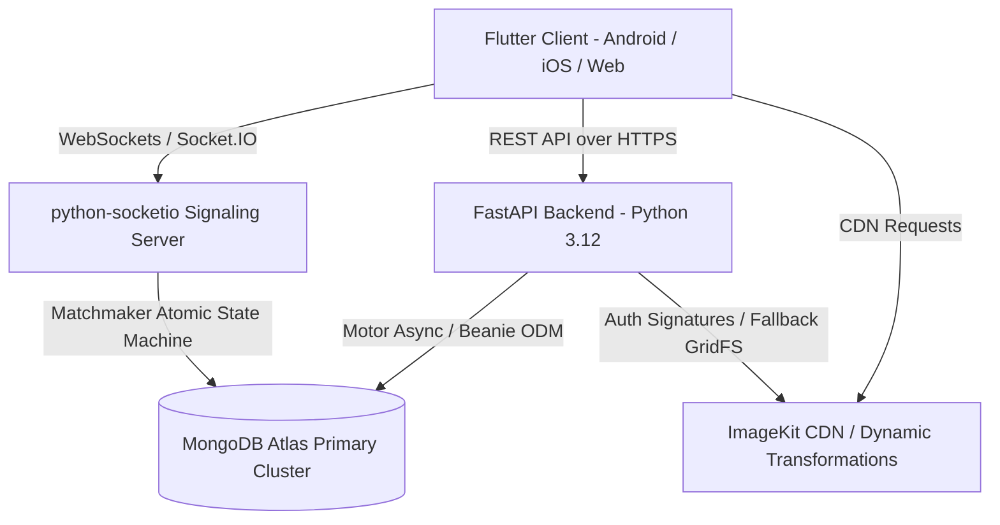
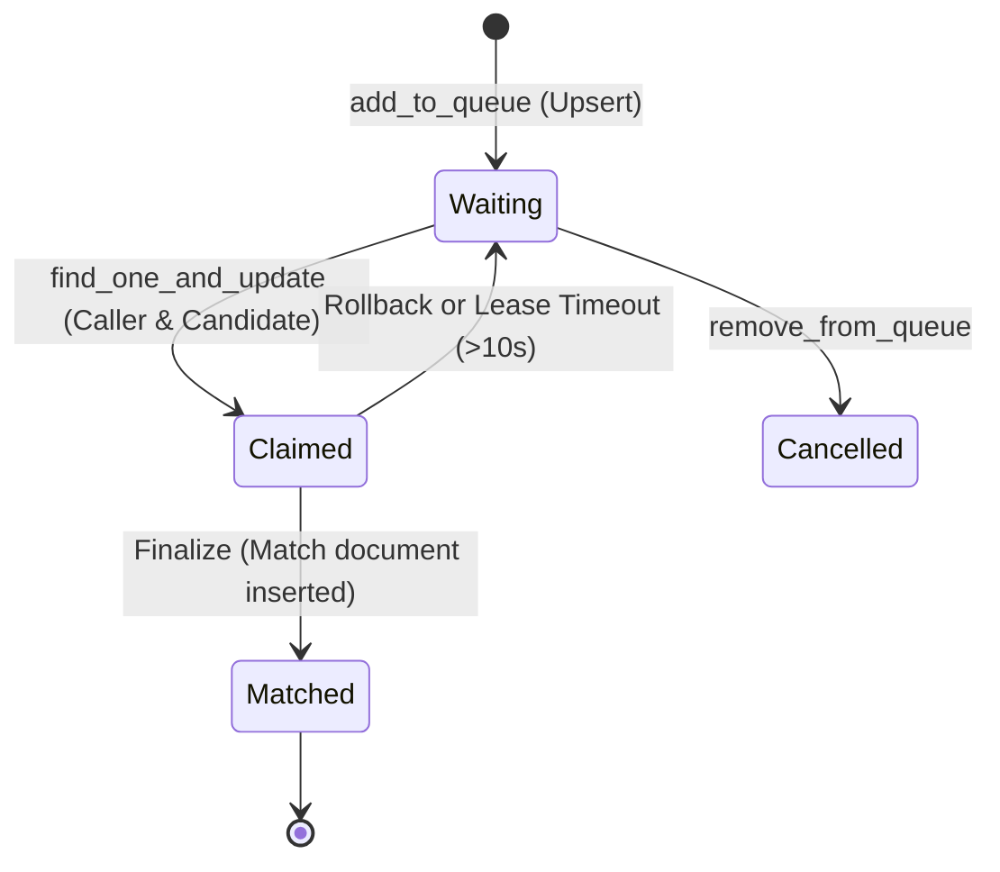

# MongoDB Architecture: Zenvora Platform

## 1. Architectural Overview
The Zenvora backend has been completely transitioned to a unified **MongoDB Atlas** database architecture.
Previously, PostgreSQL (via Supabase) was used as a secondary database solely for a transactional `match_queue` table. Now, all platform persistence—including high-concurrency matchmaking queues, user accounts, posts, chats, voice rooms, reports, admin audit trails, stories, and matches—is managed centrally in MongoDB Atlas via Motor and Beanie ODM.



---

## 2. High-Concurrency Matchmaking Concurrency Control

### Replacing PostgreSQL `FOR UPDATE SKIP LOCKED`
In high-concurrency matchmaking, multiple users enter the stranger queue simultaneously. Two users must never be paired with more than one partner or left in inconsistent states.

In MongoDB, this is achieved using **Atomic State Transitions with Temporary Leases**:



### Key Concurrency Mechanics
1. **Atomic Candidate Claiming:**
   - Both the caller and target candidate are claimed exclusively via `collection.find_one_and_update`.
   - The filter ensures status is `"waiting"` or `"claimed"` with an expired lease:
     ```python
     filter = {
         "user_id": candidate_id,
         "$or": [
             {"status": "waiting"},
             {"status": "claimed", "lease_expires_at": {"$lt": now}}
         ]
     }
     ```
2. **Session Isolation:**
   - A unique UUID `matching_session_id` tags both claimed records.
3. **Automatic Crash Recovery:**
   - A 10-second lease window (`lease_expires_at`) prevents orphaned locks. The background adaptive worker routinely recovers any expired claims back to `"waiting"`.
4. **Idempotency & Clean Rollback:**
   - If pairing cannot be finalized, claimed records under that `matching_session_id` are reset safely to `"waiting"`.

---

## 3. Database Connection & Pooling

MongoDB connection lifecycle is managed in `models/app/core/database.py`:
- **Pool Size:** `minPoolSize=5`, `maxPoolSize=50`
- **Timeouts:** `serverSelectionTimeoutMS=5000`, `connectTimeoutMS=10000`, `socketTimeoutMS=20000`
- **Retry Mechanism:** `retryWrites=True` enabled
- **Graceful Lifecycle:** Connected on FastAPI `startup_event`, disconnected via `close_db()` on `shutdown_event`.

---

## 4. Media Storage & CDN Integration

1. **Provider:** ImageKit (`ik.imagekit.io`).
2. **Dynamic CDN Optimization:** Flutter client requests images with `tr=w-...,q-...,f-auto` parameters. WebP/AVIF format auto-negotiation reduces bandwidth while maintaining crisp retina display quality.
3. **Fallback Resiliency:** If ImageKit credentials are not supplied in `.env`, the backend gracefully persists and serves avatar and story media through MongoDB GridFS.
